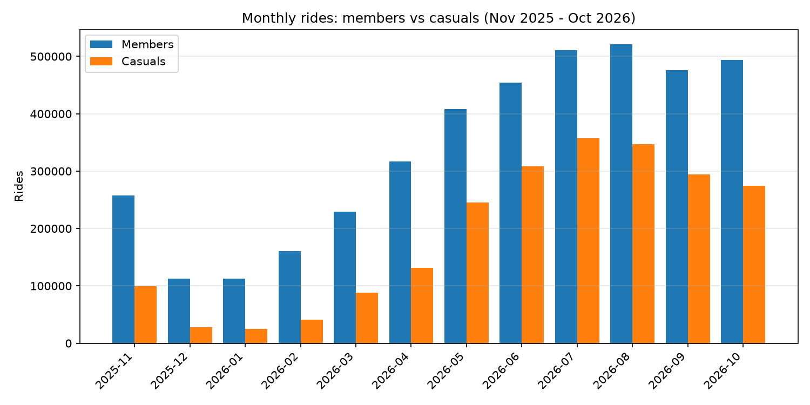
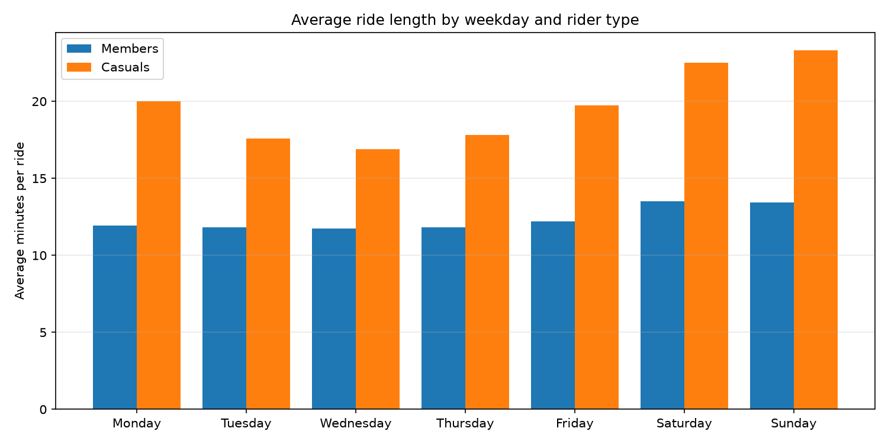
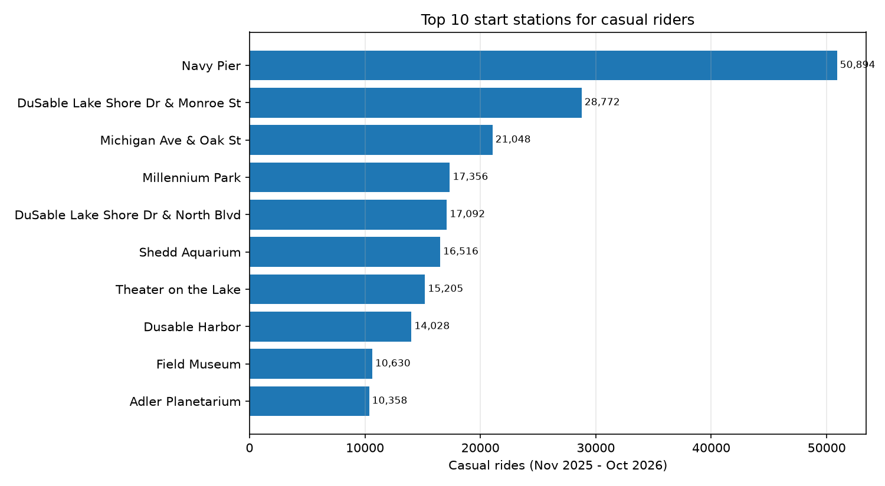

# Cyclistic Bike-Share: How Casual Riders Differ and What Would Convert Them

I analyzed 12 months of Chicago bike-share trips to answer one question: how do casual riders use the bikes differently from annual members, and what would convince more casual riders to buy a membership?

## Ask

I took the role of a junior analyst on the Cyclistic marketing team. Leadership wants to grow the business by converting casual riders into annual members, because members are more profitable over time. My task was to find how the two groups differ in riding habits and to recommend marketing actions that could drive conversions. I needed real findings with trip counts behind them, plus a plan aimed at the casuals most likely to join.

## Prepare

I worked with the public Divvy monthly trip files covering Nov 2025 to Oct 2026. Each month arrives as one zip holding one CSV, and all 12 files share the same 13 columns: ride id, bike type, timestamps, start and end station names and ids, coordinates, and rider type. I stored the raw zips under data_raw/ and kept a data dictionary with them. One quirk I found while loading: the January zip names its inner CSV 202501 while the trips inside are January 2026, so I verified the date range from the timestamps themselves. Two tiny spillovers cross the window edges, 128 trips starting Oct 31 and 194 ending Nov 1, and I kept both since they overlap the window.

## Process

I combined the 12 files with a Python and DuckDB pipeline in sql/build_clean.py and documented every rule in sql/cleaning.sql, so anyone can rerun the full build from the repo root. I started with 6,294,451 raw rows and finished with 6,293,342 clean rides after removing 1,109 rows: 35 duplicate ride ids, 29 rides with negative durations, and 1,045 depot, warehouse, or test station rides. I deliberately kept 5,148 rides over 24 hours and the 1.3 million rides with blank station names, which are mostly dockless e-bike trips with no fixed dock. Because a few very long rides pull averages upward, I report medians next to means everywhere it matters. The cleaned table lives in data_clean/trips_clean/ as partitioned Parquet.

## Analyze

Members take 64.42% of all rides (4,054,095) and casuals take 35.58% (2,239,247). The headline split hides very different habits, and every query below lives in sql/analysis.sql as Q1 to Q8.

Casuals ride for fun and members ride to get somewhere. The average casual ride lasts 20.14 minutes against 12.27 for members, and the medians agree at 10.73 versus 8.50. The gap holds in every single month, from 4.9 minutes in January to 9.5 in May, so it reads as a habit rather than a season.

Weekends belong to casuals. On Saturdays casuals take 482,000 rides averaging 22.5 minutes, and on Sundays 363,000 rides averaging 23.3 minutes, while midweek they drop to about 260,000 rides a day. Members do the opposite: they peak on Tuesdays with 661,000 rides, stay near 12 minutes all week, and dip on Sundays. That split looks like commuting against leisure.

Summer is casual season. July brought 869,000 rides with a 41.2% casual share, while January brought 138,000 rides with only an 18.0% casual share. Winter cycling in Chicago is almost entirely members, which tells me membership already means year-round riding while casual riding is a fair-weather habit I can sell into.

The classic-bike day trip is the standout casual behavior. Casuals on classic bikes average 39.8 minutes a ride with a median of 15.7, far above members on classic bikes at 15.2 and far above anyone on e-bikes at 14.0 for casuals and 11.0 for members. A casual rider taking a classic bike out for 40 minutes is exactly the person for whom a membership could pay off fast.

Casual trips cluster on the lakefront leisure corridor. The top casual start stations are Navy Pier with 50,894 rides, then DuSable Lake Shore Dr and Monroe, Michigan Ave and Oak, Millennium Park, the Shedd, Theater on the Lake, Dusable Harbor, the Field Museum, and the Adler. Those are tourists and weekend wanderers rather than commuters, and they mark exactly where a membership pitch would be seen.

## Share

I built three charts from the cleaned Parquet with charts/make_charts.py, and I am rebuilding the same views in Tableau Public following tableau/TABLEAU-CONNECT.md.

Monthly volume shows the seasonal swing. July towers over January, and the casual slice grows and shrinks with the weather.

Weekday averages show the habit split. Casual durations spike on weekends while member durations stay flat near 12 minutes all week.

Top casual stations show the geography. Navy Pier leads with 50,894 casual rides and the rest of the top 10 sits on the same lakefront corridor.

## Act

My three recommendations target the casual riders whose habits already look expensive per ride.

1. Put the membership pitch where casuals already ride: the lakefront corridor on summer weekends. I would place kiosks or staffed tents at Navy Pier, Millennium Park, and the museum campus from May through August weekends, when casual volume and the duration gap both peak. The message follows directly from the numbers: when Saturday rides average more than 20 minutes, a membership beats paying per ride.

2. Aim a conversion offer at long-ride classic-bike casuals. They average nearly 40 minutes a ride, so I would show them the break-even math directly and pair it with a first-month trial that starts on the day they ride rather than the day they sign up. This group already rides long enough that membership pays; they only pay like tourists today.

3. Convert summer casuals before winter takes them away. Casual share falls from 41% in July to 20% by December, so I would run the membership push in September and October at the same lakefront stations while summer riders are still around. Members keep riding through winter at about 115,000 rides a month, which is the strongest proof that the membership habit sticks once it forms.

## What I'd do differently

I would add price data earlier. I can show that long casual rides would benefit from membership, but without the per-ride price and the annual fee I cannot compute the true break-even ride count, so my pitch math stays directional. I would also validate the station story with a map check, since station names alone cannot prove tourist intent. Given more time I would join weather data to separate the temperature effect from the calendar effect in the summer spike, and I would build the Tableau dashboard first so stakeholders could filter the patterns themselves before I locked the recommendations.
